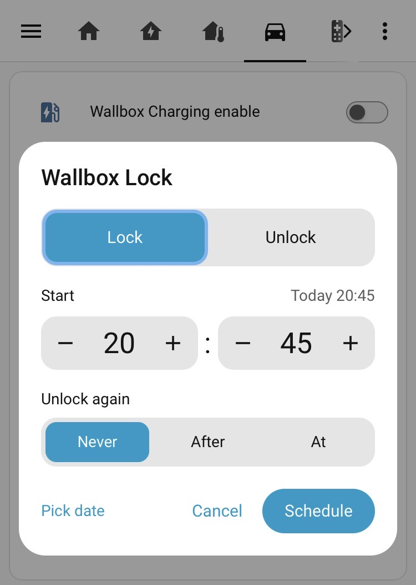

# Quick Scheduler

Long-press an entity on a Home Assistant dashboard to schedule it, for example
"lock the Wallbox at 22:00" or "turn on the heater at 06:30 and off again
1 h 30 min later".



Quick Scheduler is a single frontend module with no build step. It creates
one-shot schedules in
[scheduler-component](https://github.com/nielsfaber/scheduler-component), so
they also show up in [scheduler-card](https://github.com/nielsfaber/scheduler-card)
and remove themselves after they run.

## Requirements

- Home Assistant 2026.11 or later (for the Marketplace install).
- [scheduler-component](https://github.com/nielsfaber/scheduler-component),
  providing the `scheduler.add` service.
- [scheduler-card](https://github.com/nielsfaber/scheduler-card) is optional,
  for viewing or removing schedules.

## Installation

### Marketplace (recommended)

[](https://my.home-assistant.io/redirect/marketplace_repository/?owner=jagheterfredrik&repository=quick-scheduler&category=plugin)

1. Select the button above, or go to **Settings** > **Marketplace** >
   **Add from link** (requires the Marketplace's GitHub connection), enter
   `jagheterfredrik/quick-scheduler`, and select **Add**. If asked for a type,
   choose **Dashboard**.
2. Install it from the repository page.
3. Reload the browser. In the companion app you may need to clear the frontend
   cache.

The Marketplace registers the dashboard resource
`/local/community/quick-scheduler/quick-scheduler.js` for you. If your
dashboard resources are managed in YAML, add it yourself:

```yaml
lovelace:
  resources:
    - url: /local/community/quick-scheduler/quick-scheduler.js
      type: module
```

Updates appear under **Settings** > **Updates**.

### Manual

1. Copy `quick-scheduler.js` to `/config/www/`.
2. Add it to `configuration.yaml` and restart Home Assistant:
   ```yaml
   frontend:
     extra_module_url:
       - /local/quick-scheduler.js
   ```
3. Hard-refresh the browser. Later updates of the file only need another hard
   refresh.

## Configuration

Set the `hold_action` of any card or entity row that supports actions:

```yaml
type: tile
entity: light.kitchen
hold_action:
  action: fire-dom-event
  quick_scheduler: true
```

```yaml
type: entities
entities:
  - entity: lock.wallbox_lock
    hold_action:
      action: fire-dom-event
      quick_scheduler: true
      entity: lock.wallbox_lock # optional
```

`entity` defaults to the entity of the card or row that sent the event. Set it
explicitly if a long-press does nothing.

## Usage

Long-press the card or row to open the dialog:

- **Action** – Turn on / Turn off (Lock / Unlock for locks, Open / Close for
  covers).
- **Start** – a time within the next 24 hours, in 15-minute steps. A time that
  has already passed today means tomorrow. Defaults to the next quarter hour.
- **Turn off again** (named after the opposite action):
  - **Never** (default) – only the start action is scheduled.
  - **After** – a duration from the start, e.g. 2 h 15 min.
  - **At** – a clock time; if earlier than the start, it means the next day.
- **Pick date** – switch to date and time fields (any minute) to schedule
  further ahead. **Next 24 h** switches back.

The resolved time is shown next to each label, e.g. "Tomorrow 06:30".

## How it works

The `fire-dom-event` action dispatches an `ll-custom` DOM event carrying the
action config. It bubbles to `window`, where the module picks up configs with
`quick_scheduler: true`.

On save, the dialog calls `scheduler.add` for the start action, and again for
the revert action if an end is set (scheduler-component only runs actions at a
timeslot's start). Each schedule uses `repeat_type: single`, one timeslot, and
`start_date` = `end_date` = that day.

| Domain | Services |
| --- | --- |
| `lock` | `lock.lock`, `lock.unlock` |
| `cover` | `cover.open_cover`, `cover.close_cover` |
| Anything else | `homeassistant.turn_on`, `homeassistant.turn_off` |

## Limitations

- Times come from the browser's clock while the scheduler uses the server's
  time zone; the two must match.
- The dialog uses its own styling and English text, not Home Assistant's
  translations or `ha-*` components (which aren't a stable API).
- Times are always shown in 24-hour format.
- scheduler-card's editor works in 15-minute steps. Schedules created at other
  minutes run on time, but editing them in the card may round the time.

## Development

`test.html` loads the module with a fake `hass` object that logs service calls.
Serve the folder (ES modules don't load from `file://`):

```sh
python3 -m http.server 8765 --bind 127.0.0.1
```

Then open http://127.0.0.1:8765/test.html and click **Long-press me**.

### Releasing

The Marketplace installs the latest published GitHub release (a tag alone isn't
enough; without any release, users get the latest commit on the default
branch). Attaching `quick-scheduler.js` to the release is optional, since the
file is also taken from the repository root. The `Validate` workflow runs
`hacs/action` with category `plugin`.

## License

[MIT](LICENSE)
